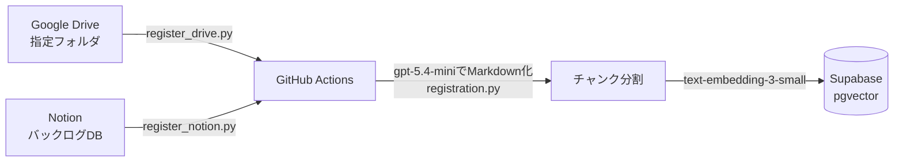
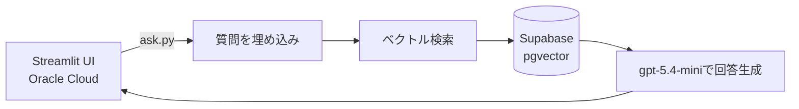

# AI Librarian

学内資料（Google Driveに置かれたPDF・画像・Office文書、Notionのページ）を横断検索し、質問に対して出典付きで回答するRAGシステムです。

## 概要

Google Driveの指定フォルダやNotionデータベースに資料を置いておくと、定期実行されるジョブが自動で内容を取り込み、ベクトル検索可能な形でデータベースに登録します。利用者はチャットUIから自然文で質問し、登録済みの資料の中から関連する箇所を検索した上で、それを根拠とした回答を得られます。

- PDF・画像はページを画像化し、LLMにMarkdown化させて取り込む（表構造も崩さず保持）
- Excel・PowerPointはライブラリで構造化データとして直接Markdown化する
- 質問にはベクトル検索に加えてキーワード完全一致検索を組み合わせ、固有名詞の取りこぼしを補う
- 回答には根拠資料へのMarkdownリンクを自動で挿入する

## 構成

**取り込みの流れ**

**応答の流れ**

- **取り込み**: GitHub ActionsからOracle Cloud VM上のsystemdタイマー経由で`register_drive.py` / `register_notion.py`を定期実行し、未登録・更新分だけを差分登録する
- **検索・回答**: `ask.py`がSupabase pgvectorでのベクトル検索とキーワード完全一致検索を組み合わせて根拠を集め、Azure OpenAIで回答を生成する
- **UI**: `app.py`（Streamlit）が共有パスワードでのログイン、検索範囲（フォルダ単位）の絞り込み、質問履歴の検索を提供する